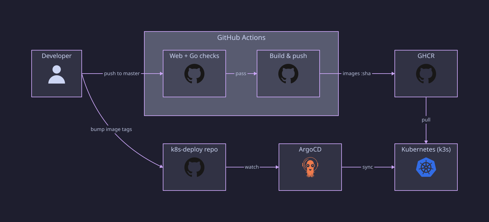

# Media Notes

Media Notes turns a video or audio file into a timestamped transcript, a
cited summary, keywords, keypoints, notes, and a summary audio, each linked
to the moment in the recording it came from. Every upload triggers several
independent AI calls that can each fail on their own and must bill credit
correctly even on a partial failure. Seven independently deployable
services split that problem in two: requests that need an immediate
answer, served over gRPC behind one GraphQL gateway, and long background
jobs, carried over Kafka and coordinated by a workflow engine.

## Features

- **Selective processing**: six independently priced steps, `transcribe`,
  `summarize`, `extract_keywords`, `extract_keypoints`, `generate_notes`,
  and `generate_audio_summary`. Only the steps you select run and get
  billed.
- **Custom prompts**: save your own instruction for each LLM step
  (summary, keywords, keypoints, notes); it is appended to that step's
  prompt on every processing request.
- **Voice selection**: `generate_audio_summary` accepts an optional TTS
  voice, per request.
- **Automatic thumbnails**: generated for every video upload, not billed;
  you can also upload your own.
- **Broad format support**: MP4, MOV, MKV, WebM, MP3, WAV, or M4A up to
  500 MiB, checked against the stored object rather than trusted from the
  client.
- **Reprocessing**: add or regenerate outputs for media that already
  finished processing.
- **Trash**: deleted media can be restored for 30 days before it is removed
  for good.
- **Standalone audio**: paste text, or describe what you want and let the
  LLM draft a script, then turn it into speech.
- **Credit-based billing**: each step reserves credit up front, settles on
  success, and releases it on permanent failure.
- **Subscriptions and top-ups**: credits are purchased through Polar-backed
  checkout exposed by `hermes`.

## Architecture


The browser only talks to `web`, and `web` only talks to `hermes`. There are
two paths through the system:

- **Request path (synchronous)**: `hermes` exposes GraphQL and calls
  `identity`, `billing`, `media`, and `content` over gRPC with a deadline on
  every call. Used for everything that needs an immediate answer.
- **Processing path (asynchronous)**: `media` publishes a processing request
  to Kafka, `conductor` splits it into steps, and `conductor-worker`
  replicas run each step (Whisper, Gemini, TTS). Results are saved in
  `content`, and the final outcome flows back to `media` and `billing`.

| Service | Responsibility |
| --- | --- |
| **hermes** | Public GraphQL API. Auth, request limits, aggregates responses |
| **identity** | Users, accounts, sessions |
| **billing** | Subscriptions, credit reservation and settlement |
| **media** | Uploads, source-media metadata, processing requests |
| **content** | Transcripts, summaries, keywords, keypoints, notes, summary audio |
| **conductor** | Workflow orchestration: dependencies, joins, retries, timeouts |
| **conductor-worker** | Whisper, Gemini, and TTS execution as a Kafka consumer-group pool |

## How it works

### Upload

The file goes straight from the browser to MinIO, so media bytes
never pass through the services.


### Processing

Only the steps the user selected run. Transcription goes first because
every other step reads the transcript.


### Retry and failure

Kafka delivery is at-least-once and every command carries an idempotency
key, so a crashed worker resumes from the last completed step. Each step
moves through the same lifecycle:


A retriable failure is redispatched with an incremented attempt, up to
`CONDUCTOR_MAX_STEP_ATTEMPTS` (3 by default). Once exhausted, the event
goes to the dead-letter queue, the workflow is marked failed, and `billing`
releases the reserved credit. Each `conductor-worker` command has
its own timeout (`WORKER_STEP_TIMEOUT_SECONDS`, 600s by default).

## Deployment



Every push to `master` runs the CI workflow (`.github/workflows/ci.yml`):
web build, lint, type-check, and tests, then build and tests for every Go
service. When both pass, it builds and pushes to GHCR, tagged with the commit
SHA and `latest`:

- one app image per component: `web`, `hermes`, `identity`, `billing`,
  `media`, `content`, `conductor`, and `conductor-worker`;
- one migration image for each service that owns a database: `identity`,
  `billing`, `media`, `content`, and `conductor`.

Deployment is GitOps. The Kubernetes manifests live in a separate repository,
`k8s-deploy`, and ArgoCD keeps the k3s cluster in sync with it:

- A release is a commit to `k8s-deploy` that bumps the image tags to the new
  commit SHA.
- ArgoCD's `root` application (app-of-apps) manages two applications:
  `common` runs Postgres, Kafka, Redis, and MinIO in the `common` namespace,
  and `media-notes` runs the eight components in the `media-notes`
  namespace. Both sync automatically with prune and self-heal.
- Each release runs the five migration Jobs, named after the commit SHA, in
  sync wave 0, before the Deployments roll out in wave 1.
- Traefik serves `medianotes.app.bbmonster.online` (web) and
  `medianotes.api.bbmonster.online` (hermes and billing's Polar webhook).

## Getting Started

### Installation

Requirements:

- Docker with Docker Compose for infra (Postgres, Kafka, Redis, MinIO).
- Go 1.26.4 or newer for the six Go services.
- Node.js and pnpm 10 for the web app.
- Python 3.11 or newer for `conductor-worker`.

Each service loads its own `.env`, copied from `.env.example` on first run
by its `make <service>:run` target.

### Running Locally

```bash
make infra:up            # Postgres, Kafka, Kafka UI, Redis, MinIO
make identity:migrate && make billing:migrate && make media:migrate \
  && make content:migrate && make conductor:migrate
```

```bash
make identity:run
make billing:run
make media:run
make content:run
make conductor:run
make hermes:run
make web:dev
```

Web: `http://localhost:5173`. hermes GraphQL: `http://localhost:8086/graphql`.

Or bring everything up in containers: `docker compose --profile app up --build`.

### Testing

```bash
make build             # build the web app and every v2 service
make lint              # lint the web app
make typecheck         # type-check the web app
make test              # run web and v2 service tests
make check             # everything CI runs
```

Run `make help` to list every target across the root and per-service
makefiles.

## Learn more

Full request/event flow, failure and retry behavior, and storage
boundaries live in [docs/architecture.md](docs/architecture.md). Design
decisions are in [docs/adr/](docs/adr/). Service scope and schema are in
[docs/services/](docs/services/).
