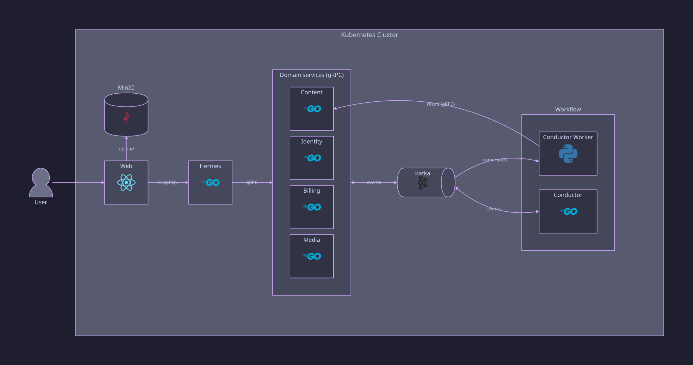
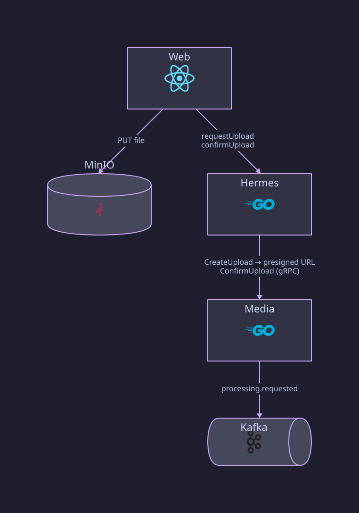
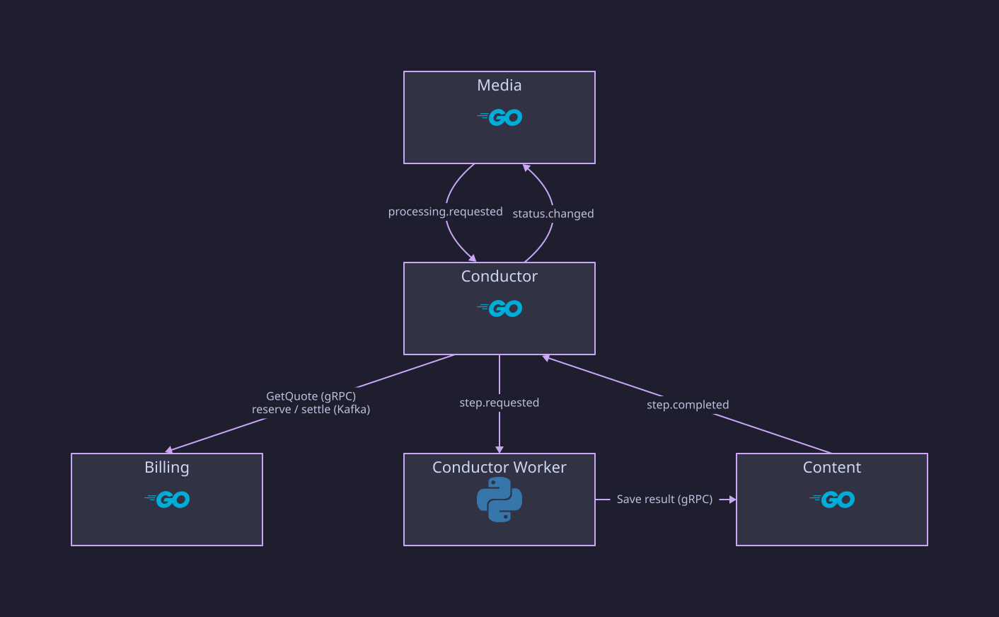

# Architecture

Media Notes has eight deployable components: the `web` app, six Go services,
and a Python worker pool. The [root README](../README.md) has the overview
diagrams; this document is the reference behind them.



| Component | Talks to | Owns |
| --- | --- | --- |
| `web` | `hermes` (GraphQL), MinIO (presigned upload) | nothing |
| `hermes` | identity, billing, media, content (gRPC) | Redis rate-limit counters |
| `identity` | Kafka | users, sessions, prompt settings, account deletion |
| `billing` | Kafka, Polar | quotes, credit, ledger, subscriptions |
| `media` | MinIO, Kafka | uploads, media metadata, trash, processing requests |
| `content` | MinIO, Kafka | transcripts, generated content, audio jobs |
| `conductor` | media, billing (gRPC), Kafka | workflows, steps, retries |
| `conductor-worker` | media, content (gRPC), MinIO, Kafka | nothing |

Rules are fixed by [ADR 0001](adr/0001-service-and-data-ownership.md): one
database per stateful service, no cross-service table access, gRPC for
synchronous calls, and versioned Kafka topics for everything asynchronous.

## Storage

| Store | Holds |
| --- | --- |
| PostgreSQL, one database per service | all structured state, including full transcripts and generated text |
| MinIO | uploaded media, thumbnails, generated audio |
| Kafka | IDs, state, object keys, attempt numbers, error codes |
| Redis | hermes rate-limit buckets |

Media bytes and long text never go through Kafka, gRPC responses carry no
media bytes, and the browser uploads straight to MinIO with a presigned URL.

Object keys:

```text
media/{media_id}/source                       uploaded file
media/{media_id}/thumbnail/v1.webp            generated thumbnail
media/{media_id}/thumbnail/{uuid}{ext}        user-uploaded thumbnail
media/{media_id}/summary-audio/{uuid}.mp3     summary audio
standalone-audio/{job_id}/{uuid}.mp3          standalone audio job
```

## Request path



`web` → `hermes` → domain services. Hermes validates the session with
identity once per request, checks ownership of every resource it returns,
applies the ADR 0004 rate limits, and sets a deadline on every downstream
call (`HERMES_DOWNSTREAM_TIMEOUT`, 5s).

Progress is delivered by polling ([ADR 0005](adr/0005-progress-update-delivery.md)):
the web polls `mediaProgress` for up to 50 in-flight media IDs, and media
returns a versioned status projection.

## Processing path




1. `ConfirmUpload` (or `RequestProcessing` to add or regenerate outputs)
   writes a processing request and `mn.media.processing.requested.v1` in one
   transaction.
2. Conductor plans the steps, gets a quote from billing over gRPC, and
   reserves credit with `mn.billing.credit.reserve.v1`.
3. Once credit is reserved, conductor dispatches steps on
   `mn.processing.step.requested.v1`: `transcribe` first; then `summary`,
   `keywords`, `keypoints`, and `notes` in parallel; then `summary_audio`
   after `summary`. Video also gets `generate_thumbnail`, which is not
   billed.
4. A worker runs the step and writes the result to content (or the
   thumbnail to media). Content commits the result and
   `mn.processing.step.completed.v1` together.
5. Conductor settles each completed step's credit, dispatches unblocked
   steps, and when every required step is done publishes
   `mn.media.status.changed.v1` and releases unspent credit.

Users can save a custom prompt per LLM option in identity. Hermes attaches
those prompts to the processing request, and they travel through the
workflow to the worker.

Topic inventory: [ADR 0003](adr/0003-kafka-topic-and-partition-strategy.md)
and its implementation status.

## Delivery and failure handling


- Delivery is at least once. Every stateful service writes state and
  outgoing events in one transaction through an outbox, and consumers drop
  duplicates with an inbox table or an idempotency key.
- A consumer commits its Kafka offset only after its state change commits.
  The worker commits only after the owning service accepted the result.
- Conductor ignores results from an old attempt. Content rejects writes
  from an older attempt within the same workflow.
- A retriable step failure is retried up to `CONDUCTOR_MAX_STEP_ATTEMPTS`
  (3) with exponential backoff and jitter. Otherwise the step goes to
  `mn.processing.dlq.v1`, the workflow fails, and the reserved credit is
  released.
- Steps have deadlines (15 min for `transcribe`, 3 min for
  `generate_thumbnail`, 5 min for the rest); a conductor scheduler expires
  them.

## Deletion


[ADR 0006](adr/0006-data-retention-and-deletion.md) defines the flow:

- **Trash:** `trashMedia` hides an item and `restoreMedia` brings it back.
  Items left in trash for 30 days are deleted permanently.
- **Permanent deletion:** media deletes its own rows and objects, then
  publishes `mn.media.deletion.requested.v1` so content and conductor delete
  theirs.
- **Account deletion:** identity revokes sessions and publishes
  `mn.identity.account.deletion.requested.v1`; media deletes the user's
  media.

Completion is not joined back yet, so deletion operations stay pending.
See ADR 0006's implementation status.

## Standalone audio


Independent of any media item: hermes asks content for a script draft or a
TTS job, content publishes `mn.audio.job.requested.v1`, and a worker runs it
and reports back to content over gRPC. Conductor and billing are not
involved.

## Not implemented

- Tracing and metrics; services only write structured logs.
- Aggregate provider quotas ([ADR 0007](adr/0007-provider-quota-and-admission-control.md)).
- The four-hour source duration limit from ADR 0004.
- Automatic releases. CI pushes images to GHCR; deploying them is a manual
  tag bump in the `k8s-deploy` GitOps repository, which ArgoCD syncs
  ([continuous integration](continuous-integration.md)).
