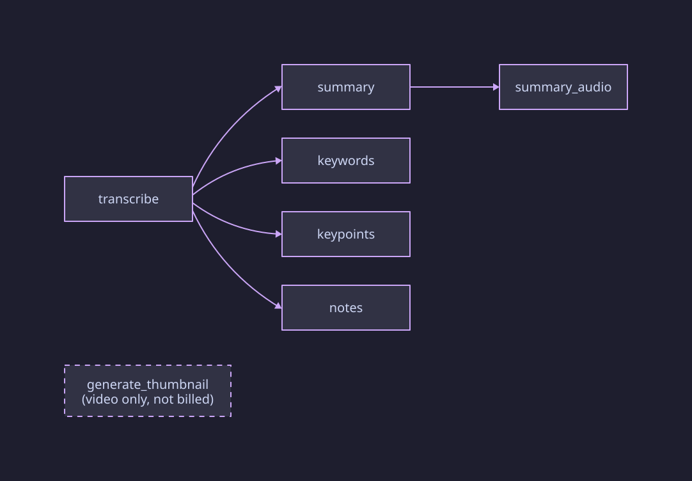
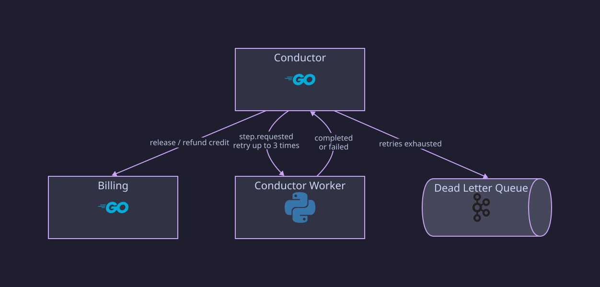

# Conductor

Go service, driven only by Kafka, that owns processing workflows: steps,
dependencies, attempts, retries, timeouts, and joins. It never runs AI,
touches media bytes, stores generated content, or changes credit balances.

## Structure

```text
cmd/conductor/main.go
internal/app/        config, logging, health
internal/workflow/   step planning and workflow state machine
internal/retry/      exponential backoff with jitter
internal/timeout/    per-step deadlines
internal/clients/    gRPC clients: media GetMedia, billing GetQuote
internal/events/     outbox relay and consumers
internal/store/      PostgreSQL repositories (workflows, DLQ records, inbox, outbox)
migrations/          V1 init … V4 prompt overrides
```

## Data

Database `workflow`, schema `public`: `workflows`, `workflow_steps`,
`step_dependencies`, `step_attempts`, `deletion_operations`, `inbox_events`,
`outbox_events`.

`workflows` also stores the quote ID, the optional TTS `audio_voice` (`V2`),
and the user's `prompt_overrides` (`V4`). A partial unique index allows at
most one active workflow per media item (`V3`); finished workflows stay as
history.

## Workflow



1. **Start:** on `mn.media.processing.requested.v1`, conductor reads the media
   item from media, plans the steps, gets a quote from billing over gRPC, and
   publishes `mn.billing.credit.reserve.v1`. The workflow is
   `reserving_credit`.
2. **Reserve:** a rejected reservation fails the workflow. An accepted one
   moves it to `running` and dispatches every step whose dependencies are
   done.
3. **Steps:** `transcribe` runs first. `summary`, `keywords`, `keypoints`,
   and `notes` depend on it and run in parallel. `summary_audio` depends on
   `summary`. Video also gets a `generate_thumbnail` step, which is not
   billed and does not block completion.
4. **Completion:** each `mn.processing.step.completed.v1` marks the step done,
   publishes a `settle_item` credit command, and dispatches newly unblocked
   steps. When every required step is done the workflow is `completed`,
   media gets `mn.media.status.changed.v1`, and any unspent reserved credit
   is released with a `release_remainder` command.
5. **Failure:** a retriable failure below `CONDUCTOR_MAX_STEP_ATTEMPTS` (3)
   is retried after 5s doubling to at most 5 min, with up to 20% jitter.
   Otherwise the step goes to `mn.processing.dlq.v1`, the workflow fails,
   media is told, and the credit remainder is released.
6. **Timeouts:** a scheduler runs every 5s to dispatch due retries and expire
   steps past their deadline: 15 min for `transcribe`, 3 min for
   `generate_thumbnail`, 5 min for the rest.

The retry and failure path:



Every handler is idempotent: inbox records drop duplicates, and results
for an old attempt are ignored. All state changes and outgoing events commit
together through the outbox.

## Events

| Direction | Topic |
| --- | --- |
| Consumes | `mn.media.processing.requested.v1`, `mn.processing.step.completed.v1`, `mn.processing.step.failed.v1`, `mn.media.derivative.ready.v1`, `mn.billing.credit.reserved.v1`, `mn.billing.credit.settled.v1` (logged only), `mn.media.deletion.requested.v1` |
| Publishes | `mn.processing.step.requested.v1`, `mn.media.status.changed.v1`, `mn.billing.credit.reserve.v1`, `mn.billing.credit.settle.v1`, `mn.processing.dlq.v1`, `mn.conductor.deletion.completed.v1` (no consumer yet) |

## Not implemented

- Aggregate provider quota admission (ADR 0007).
- DLQ replay tooling.

## Runtime

HTTP on 8085 (`/health/live`, `/health/ready`); no gRPC server.
