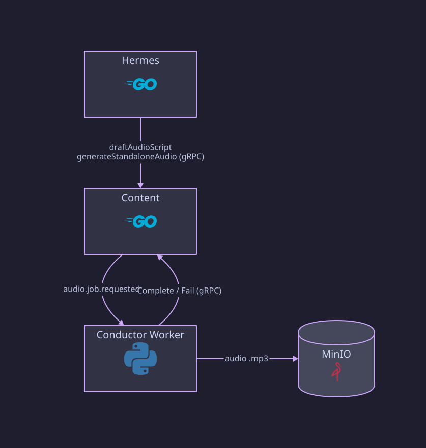

# Content

Go gRPC and Kafka service owning transcripts, generated content (summary,
citations, keywords, keypoints, notes), summary-audio metadata, and
standalone audio jobs. It does not own uploads or workflow decisions.

## Structure

```text
cmd/api/main.go
internal/app/          config, logging, health
internal/content/      transcript and generated-content writes and reads
internal/audiojob/     standalone script-draft and TTS jobs
internal/deletion/     per-media deletion
internal/grpc/         gRPC server and error mapping
internal/events/       outbox relay, deletion consumer
internal/objectstore/  presigned URLs for audio objects
internal/store/        PostgreSQL repositories
migrations/            V1 init, V2 step attempts per workflow, V3 audio jobs
```

## Data

Database `content`, schema `public`: `contents`, `transcript_segments`,
`summaries`, `summary_sentences`, `summary_citations`, `keywords`,
`keypoints`, `notes`, `audio_summaries`, `content_step_attempts`,
`content_deletions`, `standalone_audio_jobs`, `inbox_events`,
`outbox_events`.

Audio bytes live in MinIO; the database keeps only the object key. A
`SummaryAudio.url` is signed fresh on every read and never stored.

## gRPC API

`media_notes.content.v1.ContentService`:

- Worker writes: `StoreTranscript`, `StoreSummary`, `StoreKeywords`,
  `StoreKeypoints`, `StoreNotes`, `StoreSummaryAudioMetadata`
- Reads: `GetTranscript` (worker), `GetContent` (hermes)
- Audio jobs from hermes: `RequestScriptDraft`, `RequestStandaloneAudio`,
  `GetStandaloneAudioJob`, `ListStandaloneAudioJobs`
- Audio jobs from the worker: `CompleteScriptDraft`, `CompleteStandaloneAudio`,
  `FailStandaloneAudioJob`

## Behavior

- **Durable before completion:** each `Store*` call commits the result and
  its `mn.processing.step.completed.v1` outbox event in one transaction, so
  conductor never sees a step complete before its output exists.
- **Duplicates and stale attempts:** writes are deduplicated per
  `(content_id, step, workflow_id)`. A write with an older attempt than the
  last one recorded is rejected. Scoping by workflow lets a new processing
  request for the same media start again from attempt 1.
- **Regenerate:** a new workflow's write replaces that step's content rather
  than adding to it.
- **Standalone audio:** a user pastes text, or describes what they want and
  an LLM drafts the script, then TTS synthesizes it. Jobs are keyed by
  `user_id` with no media item or conductor workflow. Content publishes
  `mn.audio.job.requested.v1`, the worker runs the job, then calls
  `Complete*` or `FailStandaloneAudioJob` directly. Job status is
  `generating`, `completed`, or `failed`.

## Standalone audio flow



## Events

| Direction | Topic |
| --- | --- |
| Publishes | `mn.processing.step.completed.v1`, `mn.audio.job.requested.v1`, `mn.content.deletion.completed.v1` (no consumer yet) |
| Consumes | `mn.media.deletion.requested.v1` |

## Not implemented

- Billing for standalone audio jobs.

## Runtime

HTTP on 8084 (`/health/live`, `/health/ready`), gRPC on 9095.
