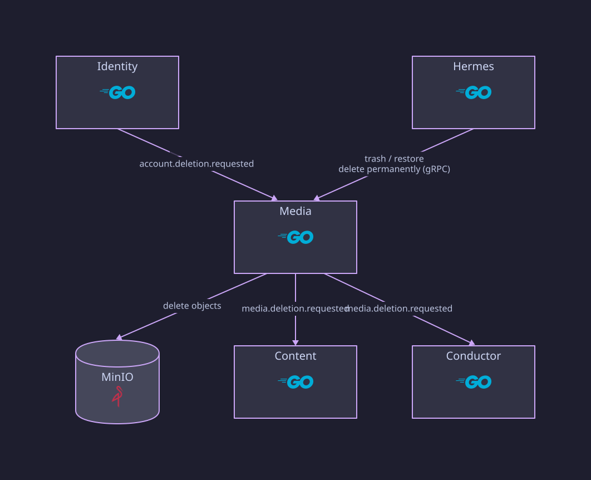

# Media

Go gRPC and Kafka service owning upload sessions, source-media metadata,
derivatives (thumbnails), processing requests, trash, and media deletion. It
does not own transcripts, generated content, workflows, or credit.

## Structure

```text
cmd/api/main.go
internal/app/          config, logging, health
internal/upload/       upload sessions and confirmation
internal/media/        media metadata, listing, trash
internal/derivative/   thumbnail upload and registration
internal/processing/   processing requests
internal/deletion/     deletion operations
internal/grpc/         gRPC server and error mapping
internal/events/       outbox relay, consumers, trash purge sweep
internal/objectstore/  MinIO presigning and object metadata
internal/store/        PostgreSQL repositories
migrations/            V1 init … V5 trash
```

## Data

Database `media`, schema `public`: `media`, `upload_sessions`,
`processing_requests`, `derivatives`, `media_deletions`, `inbox_events`,
`outbox_events`.

| Migration | Change |
| --- | --- |
| `V2` | `media.version`, a monotonic counter for progress polling (ADR 0005) |
| `V3` | `media.description` |
| `V4` | drops `processing_requests` unique `media_id`, adds a unique `idempotency_key` |
| `V5` | `media.trashed_at` |

## gRPC API

`media_notes.media.v1.MediaService`, used by hermes, conductor, and the
worker:

- Upload: `CreateUploadSession`, `ConfirmUpload`
- Read: `GetMedia`, `ListMedia`, `GetMediaProgress`, `SignPlaybackUrl`
- Edit: `UpdateMedia`, `RequestProcessing`
- Thumbnails: `RegisterDerivative` (worker), `RequestDerivativeUpload`
  (a user uploading a custom thumbnail through hermes)
- Trash and deletion: `TrashMedia`, `RestoreMedia`, `ListTrashedMedia`,
  `RequestDeletion`, `GetDeletionStatus`

## Behavior

- **Upload:** `CreateUploadSession` checks the MIME type, the declared size
  (at most 500 MiB), and at most three active sessions per user, then
  returns a presigned PUT URL. `ConfirmUpload` reads the real object metadata
  from MinIO, rejects a missing, empty, or oversized object or an expired
  session, and writes the processing request and its outbox event in one
  transaction.
- **Processing again:** `RequestProcessing` starts a new request for media
  that already finished (`completed` or `failed`), to add or regenerate
  outputs. Only one request may be active per media item; the media row is
  locked for the check.
- **Progress:** `GetMediaProgress` returns status for up to 50 media IDs in
  one call, for the web's polling (ADR 0005).
- **Trash:** `TrashMedia` hides an item; `RestoreMedia` brings it back. A
  sweep permanently deletes items that stay in trash for 30 days.
- **Deletion:** `RequestDeletion` (the web's "delete permanently", and the
  trash sweep) deletes media's own rows and objects, then publishes
  `mn.media.deletion.requested.v1` so content and conductor delete theirs.
- **Playback:** `SignPlaybackUrl` returns a 15-minute presigned GET URL.

## Deletion flow



## Events

| Direction | Topic |
| --- | --- |
| Publishes | `mn.media.processing.requested.v1`, `mn.media.derivative.ready.v1`, `mn.media.deletion.requested.v1`, `mn.media.deletion.completed.v1` |
| Consumes | `mn.media.status.changed.v1` (workflow status), `mn.identity.account.deletion.requested.v1` |

## Not implemented

- The four-hour duration limit. `MaxDurationMs` is configured but nothing
  probes the source file's duration.
- Deletion completion from content and conductor is never recorded, so a
  deletion operation stays `pending` (see ADR 0006).

## Runtime

HTTP on 8083 (`/health/live`, `/health/ready`), gRPC on 19095.
